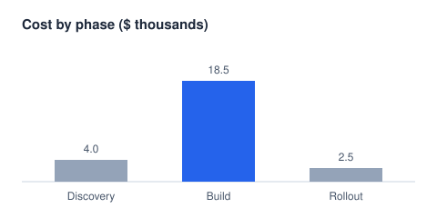

# Markmode Sample
## A tour of what the live preview renders

### A level three header

#### And level four

This paragraph has **bold text**, *italic text*, `inline code`, ~~struck text~~ and a [link to Helix](https://helix-editor.com). Move the cursor onto a line to see its raw markdown; move away and it renders again.

**Label paragraphs** open with bold, which the docx export colors as a {==mini-heading.==}{>>Along with a comment to be addressed<<}

### Lists

- First bullet, with **emphasis** mid-sentence
- Second bullet
  continued on an indented line
- [ ] An open task
- [x] A finished task

1. Numbered item one
2. Numbered item three, now reworded

### A table

| Phase | Weeks | Owner | Cost |
|---|---|---|---:|
| Discovery | 1–2 | Design | $4,000 |
| **Build** | 3–8 | Engineering | $18,500 |
| Rollout | 9 | Operations | $2,500 |
| **Total** | | | **$25,000** |

> A blockquote, for the occasional quotation.

---

### Code

```ts
function greet(name: string): string {
  return `hello, ${name}`;
}
```

### Links

- A link to another file opens it with `gf` (or Cmd-click), at the heading it names: [the README's export section](../README.md#export).
- A wiki-link finds its note by name in the workspace: [[README|the README, as a wiki-link]].
- An anchor alone moves within this file: [down to the math](#math).

### Images



### Footnotes

Footnotes keep asides out of the text.[^aside] Each reference shows as its number, with the note as a tooltip; `gf` goes to the note and back.[^second]

### Math

The area of a circle is $A = \pi r^2$, while prices like $5 and $10 stay text. A block:

$$
\int_0^1 x^2 \, dx = \frac{1}{3}
$$

That's the tour. Try `w`, `b`, `e`, `x`, `mi(`, `ms*`, Enter for jump labels, and `:export-docx`.

[^aside]: The note itself, in smaller type here and as a Word footnote in the export.
[^second]: A second note, numbered by where it is first referred to.
